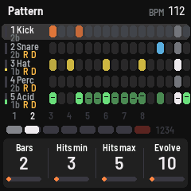
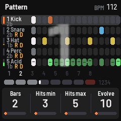
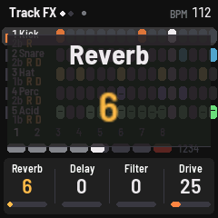

# Wild 0.3.28 - experimental FM-1 firmware

**0.3.28: songs keep their banks.** A preset is a song: saving it saves all its banks and their
automation, and loading it brings exactly those, never another song's. A song with many banks takes
more slots ("in 001" on the list). GLO + HOME clears all (asked; SAVE says yes): every bank and all
automation, saved songs kept. GLO + REC erases the selected track's automation.
**0.3.27:** SEL alone goes back to bank 1. SEL mode (A/B, Copy) is gone from the Scene page: the
banks do that now.
**0.3.26: automation.** REC, turn knobs while it plays, REC again: the moves loop with the phrase.
Turned by hand a knob is yours, and a second after you let go the automation takes it back. REC held
and a knob turned erases its automation; so does a new pattern on its track. Each bank has its own.
**0.3.25: twelve banks.** Hold SEL and press white key 1-12: a whole setup of its own (patterns,
sounds, effects, settings) comes in at once, with the tempo kept. Key 16: a new scene by chance at
each press. Undo is 6 steps now (it was 12) to make room.
**0.3.24:** a drum track on Rnd len Fixed plays its Bars: a new pattern no longer keeps a length
drawn earlier, or the one a loaded project had before Bars was turned.
**0.3.23:** the battery in the header, with how much is left in % (a lightning bolt on USB power).
**0.3.22:** any button but PLAY, SEL and REC leaves the mixer and Audio Load. GLO + black 10
makes new patterns on all tracks (was REC), GLO + black 11 new sounds on all tracks.
**0.3.21:** a soft drum hit (the step keys' second press) is velocity 50, was 64, and shows a shade
dimmer on the screen.
**0.3.20: the 303 on Open303's own voice:** its filter, saw and VCA as X0X's, with Wild's touches
on top (diodes that bend, a bowed saw, accents that build up, a VCA that rounds them, a slow drift).
Closer to a real 303, and its render about 12 % lighter.
**0.3.18: the 303 calibrated as Open303 measured a real one:** its knobs over the 303's own ranges
(cutoff 314 Hz to 2.4 kHz, decay 200 ms to 2 s), Env Mod's measured curve, the 303's quick slide, its
VCA (an accent much louder, a quick release) and the filters around its ladder; Open303's square.
**0.3.19:** the phaser, flanger, chorus and ring modulator without the bitcrusher-like grit on
bass and kicks, and flanger and chorus tails that stay clean as they fade.
**0.3.17:** Tune (drums and 303) and Pitch (drums) move a semitone every two detents and no
longer speed up on a quick turn: a sound walks up or down the notes instead of jumping.
**0.3.16:** operators that are off or have died away no longer cost render time; the drum
effects run a block at a time. Same sound, a little lighter.
**0.3.15:** the audio is rendered 6 ms further ahead (17 ms): peaks when many hits land at once no
longer drop out.
**0.3.14:** Audio Load (GLO + OCT+) shows the render's split: drums, 303, sequencer and FX, master.
**0.3.13: lighter to run, the same sound:** the audio's hot loops and their tables run from RAM
instead of through the flash's cache, and the filters no longer divide every sample. Lower Audio
Load, nothing taken away.
**0.3.12: a more analogue 303:** its saw bowed as the 303's, its filter sweeping smoothly every
sample, a VCA that rounds loud accents, and a slow drift of a few cents and a few per cent of cutoff.
**0.3.5: the 303 oversampled** (its oscillator and filter at 2x): less grit with the resonance up
and the cutoff open, about 5 % more Audio Load. **0.3.3:** no click from the Glue.
**0.3.4: drums that wander off:** a drum track's Deviance from 90 (the knob reads Wander) moves the
sound itself a little at every sixteenth, never back: out of its kind in about 128 bars at 90, 8 at
100. Up to 89 Deviance is as before.
**0.3.0 - 0.3.2: the 303's own Deviance** (the acid line's own ENV page, KNOB 1): cutoff, resonance,
Env Mod and Decay played as by a hand, following how hard the drums sound and how busy they are,
taking a break of about eight bars when it has played hard a while; turn one of them yourself and
Deviance rests until 2 s after your last turn. And a
**Major** scale for the acid line. 0.2.1: Drive without the aliasing-like grit, and a cleaner 303
square. 0.2.0: the 303's diode ladder filter, and 303 waves (Original / All) on GLOBAL's Scene page.
The diode ladder takes about 20 % more time for the acid voice: check Audio Load (GLO + OCT+) on
the FM-1. GLO + OCT- toggles the mixer; any button but PLAY, SEL and REC closes either. 0.1.0 failed hardware startup; 0.1.1 and later fix it.

Wild is a separate n001se 1.7.1 fork for the M-VAVE FM-1. It keeps the five
tracks, musical Chaos, controls, MIDI and 303 behavior, and renders continuous
PCM ahead of playback in memory. No audio files are written by the firmware.
The first renderer retains the existing 303, drums and effects. Independent
phrase sound evolution and additional sound models are future work.

- Source base: Saintpid/n001se commit b3a4ac2 (1.7.1).
- Repository: https://github.com/Saintpid/Wild
- Installable package: build/Wild-0.3.5.fwsc, identity FM-1_839.
- USB name: Wild FM-1. Screen: Wild 0.3.5.
- [Architecture, results and remaining hardware checks](docs/WILD_ENGINE.md).
- [Original request](docs/WILD_SPECIFICATION.txt). Wild overrides conflicting
  product names in that document.

With Linux/WSL prerequisites from BUILDING.md, the locally downloaded tools:

```sh
JIELI_TOOLCHAIN=build/jieli/toolchain AC79_SDK=build/sdk python3 tools/build.py --release 0.3.5 --id 839
AC79_SDK=build/sdk CC=gcc sh tests/run_tests.sh
```

The stable test alias build/Wild.fwsc is identical to the versioned package.
Physical FM-1 timing, audio and installation remain untested. Internal C names
and the documentation below are inherited from n001se; historical status and
release names below do not describe Wild's current verification status.

---

# n001se: FM percussion that never sounds the same, for the M-VAVE FM-1

n001se is a custom firmware for the **M-VAVE FM-1** that turns it into a random FM drum machine with
an acid line, for live sets. The idea comes from Beatsurfing RANDOM: minimalism with chance. Five
tracks, every hit a little different, patterns that appear by themselves and effects that move. It
must never get cluttered.

  

> **Status: 1.4.0.** 1.3.1 is tested on the FM-1; 1.4.0's new acid line is tested in the simulator.
> Install at your own risk. The platform is FiMba-1's, unchanged: the chip's own update mode cannot be
> overwritten, the firmware falls back to a safe mode if it does not start, and the original firmware
> can always be put back (see [Install](#install)).

**The full manual:** [docs/MANUAL.txt](docs/MANUAL.txt). It has every button, page, parameter and MIDI
command.

## What it sounds like

- **Four FM drums** (tracks 1–4): four operators in eight algorithms, noise and a resonator. Every
  hit varies around the sound's base (Deviance); from 90 the base itself wanders off, slowly, into
  something else (Wander). A new sound is drawn from a kind: kick, snare, hat,
  perc, click, metal or clap, and perc, click and metal land in a random octave.
- **An acid line** (track 5) after the TB-303: saw, square, pulse, tri, sine or duo through a model
  of the 303's diode ladder filter (Open303's TeeBeeFilter, its diodes bending a little), calibrated as [Open303](https://sourceforge.net/projects/open303/) (Robin Schmidt) measured a
  real 303: the knobs over the 303's ranges, Env Mod's measured curve, the 303's gate, slide (60 ms),
  accent (much louder, a sweep that builds up, weak on a slid note), its VCA, the filters around the
  ladder and its square; a saw whose ramp bows a little as the 303's, a VCA that rounds loud accents, and a slow
  analogue drift (a few cents of pitch, a few per cent of cutoff). Its own sequencer draws musical lines: the rhythm first, a motif
  that repeats, notes from the scale (minor, phrygian, dorian, pentatonic, blues, harmonic minor or
  major), octaves, accents and slides where they move the line. Its Chaos takes it from those rules
  to pure chance. Its **Deviance** plays its cutoff, resonance, Env Mod and Decay by itself, after the
  drums: harder and busier drums take it to high resonance, a middle cutoff and more Env Mod, calm
  ones back, with slow sweeps of each knob's own speed, quick twists there and back on the beat and
  now and then a move against the rules; after playing hard a while it rests for about eight bars.
- **Patterns drawn at random:** each track loops over its own length (drums 1–8 bars, acid 1–4), so
  the tracks drift against each other. Hits min–max sets how many hits a new pattern gets, and Evolve
  now and then moves a hit when the loop comes round. Any track, the 303 too, can run in
  **triplets** (HOME twice, the Rhythm page, Grid): three steps to a quarter, 12 to a bar on white
  keys 1–12, drawn on the screen where they fall in time. New drum hits are mostly strong, the
  quarters most: each is strong or soft (the step keys' two strengths), and **Dynamics** (Rhythm
  page) spreads them from there.
- **Effects per track:** reverb and delay sends drawn per hit up to the level you set, a moving
  filter, a warm drive with even harmonics that does not raise the volume (anti-aliased), and a **modulation effect**
  per sound: phaser, flanger, chorus, ring modulator or tremolo, on the share of hits you choose.
- **Chaos** brings glitches: beat repeat, reverse and tape stop. They gather at the end of bars 4 and
  8 of the phrase, as fills into the next bar; elsewhere they are short, an eighth off the beat.
  **Mutate** swaps which tracks play, a quarter at a time, in the same bars, and always goes back.
  Each track can go **past** all three: on the **Routing** page (LFO, then LFO again) set its
  **Drift** to Bypass and it goes straight to the master and the Glue, untouched by the glitches,
  with its filter standing still and its mutes left alone (a **B** on its row). Space stays for all.
  **Space** lets the reverb move between rooms (small room to large hall) and the delay between
  lengths (dotted eighth, eighth, sixteenth, quarter), slowly: a glide takes 1–4 bars and each
  place is held for a while. The delay glides like an analog delay, so its repeats bend in pitch.
- **Master:** hi cut, lo cut, resonance and **Glue**, a light mastering chain that makes the mix
  tighter and more finished but not louder: a compressor in parallel (Glue mix) with a gentle
  transient expander, an EQ that leans the mix towards a pink slope with a little air, foundation and
  de-harsh (Glue EQ), an inflator (Color) and the width with the lows kept in mono (Width), on its own
  Glue page. After it there is always a limiter (−1 dBFS with the Glue on, −0.3 dBFS off).

## Live play in short

| Control | Does |
| --- | --- |
| **White keys** | The 16 steps of the bar shown (a track in triplets: keys 1–12, three to a beat). A press: empty → strong → soft → off (303: accent → plain → off). Hold a step and turn for velocity and pitch (acid: note, accent, slide). In LIVE mode they play the sounds |
| **Black 1 / 2** | Previous / next bar (both: follow the playback) |
| **Black 3 / 4** | Undo / redo, 6 steps (within the bank) |
| **Black 5–9** | Mute tracks 1–5 |
| **Black 10 / 11** | New pattern / new sound on the selected track. With GLO held: on all tracks |
| **PLAY / SEQ** | Start/stop / switch SEQ and LIVE |
| **REC** | Automation: the knobs you turn while it plays are recorded (REC lit, its dot blinking in the header) until REC again; then they loop over 1, 2, 4 or 8 bars, in step with the phrase. A knob with automation has a red dot. Turned by hand it follows you, and the automation takes it back a second after. REC held + a knob: that knob's automation erased. A new pattern on a track erases that track's automation. GLO + REC: the selected track's automation erased |
| **GLO + HOME** | Clear all: asks, SAVE says yes. Every bank empty, all automation gone, bank 1 from the defaults; saved songs kept |
| **SAVE / ARP** | Save / load a song, all its banks (64 slots) |
| **PRESETS** | Controls any parameter, Glue to start with |
| **SEL** | Alone: back to bank 1 (in bank 1 with a scene by chance playing: out of the scene) |
| **SEL + white 1–12** | The banks: each a whole setup (patterns, sounds, effects, settings), the tempo shared. An empty one starts as a copy of the one playing. While SEL is held the keys show them: lit = playing, dim = holds one |
| **SEL + white 16** | Chance: a new scene by chance at every press (the bank keeps its original) |
| **HOME EDIT ENV FX LFO GLOBAL** | The pages. Press again for the button's next page |

In bars 4 and 8 of the phrase the beats 1–4 count big over the sequencer, so it is easy to place
breaks. When you turn a knob, the parameter's name and value show big. A quick turn moves most
knobs further; Tune and Pitch always move a semitone every two detents.

Over USB the FM-1 shows up as **n001se FM-1**: MIDI in and out and an audio input (stereo, 44.1 kHz)
that you can record straight into your computer.

## Install

The ready-built firmware file (`.fwsc`) is handed out on the author's Patreon. You can also build it
yourself from this source, see [Build and test](#build-and-test).

Install the file with M-VAVE's **M-UPGRADE**. First download M-VAVE's original firmware (FM-1 V15,
"PC Firmware" at m-vave.com/download) so you can always go back. It can also be installed from
FiMba-1's web page <https://jadamsowers.github.io/fm1-fimba/#install> in Chrome or Edge ("Or a
firmware file"), or from the command line: `python3 tools/fm1_install.py n001se.fwsc`.

To switch between Wild and NB303 (or any FM-1 firmware file) in either direction, whatever the
version number, use **FM-1 Switch** (`tools/fm1_switch.pyw`): a small window that lists the `.fwsc`
files beside it, shows what the FM-1 runs and installs the one you pick. M-UPGRADE only takes a
higher number than the one installed. If the FM-1 seems bricked, **Check FM-1** tells which state it
is in and what to do. **Rescue…** puts M-VAVE's stock firmware back on an FM-1 whose firmware no
longer starts, through the chip's own update mode (Windows and Mac, no extra hardware, a backup of
the whole flash first; see [BUILDING.md](BUILDING.md#fm-1-switch-installer-app)). `tools/build_switch_exe.bat` makes `FM1-Switch.exe` on
Windows. For the Mac, `tools/export_switch_mac.cmd` sends the sources to the synced Mac Export
folder, and on the Mac `Build_FM1Switch_Mac.command` (double-click) builds `FM1-Switch.app` and its
DMG with `tools/build_switch_mac.sh`. Without a signing identity the app is unsigned: the first
time, right-click it and choose Open.

## Build and test

The details are in [BUILDING.md](BUILDING.md) (JieLi's Linux toolchain and three files from the AC79
SDK).

```
tests/run_tests.sh      # the engine, the platform and the whole app in the simulator
./build.sh              # build/n001se.fwsc
```

**The simulator** (`build/host/n001se_host SCRIPT OUTDIR`) runs the whole firmware on a computer from
a script (`tests/scenarios/*.kal`): screenshots, audio and MIDI come out. The pictures here are its.

## Family tree and thanks

n001se stands on a chain of open firmware for the FM-1:
[Felucca](https://github.com/hugelton/Felucca) (Leo Kuroshita, Hügelton Instruments) made the FM-1
programmable; [X0X](https://github.com/charlesvestal/fm1-x0x) and
[FoMni](https://github.com/charlesvestal/fm1-fomni) (Charles Vestal) built other instruments on that
platform and added the simulator; [FiMba-1](https://github.com/jadamsowers/fm1-fimba) (Adam Sowers)
is the kalimba n001se is built from. The platform, the updater, the safe mode and the simulator are
theirs. The sound engine, the sequencer, the effects and the interface are n001se's.

## License

GPL-3.0-only, like the whole chain. See [LICENSING.md](LICENSING.md). "M-VAVE" and "FM-1" are
trademarks of their owners; n001se is independent and not affiliated with them.
