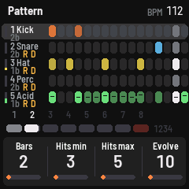
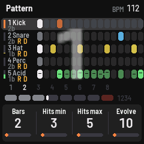
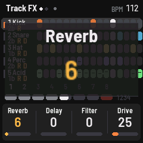

# n001se: FM-slagverk som aldrig låter likadant, för M-VAVE FM-1

n001se är en egen firmware för **M-VAVE FM-1** som gör den till en slumpande FM-trummaskin med en
acidlinje, för live. Idén kommer från Beatsurfing RANDOM: minimalism med slump. Fem spår, varje slag
lite olika, mönster som uppstår av sig själva och effekter som rör sig. Det får aldrig bli plottrigt.

  

> **Status: 1.0.0, testad på FM-1.** Installera på egen risk. Plattformen är FiMba-1:s, oförändrad:
> chipets egen uppdateringsmod kan inte skrivas över, firmwaren faller tillbaka till ett säkert läge om
> den inte startar, och originalfirmwaren går alltid att lägga tillbaka (se [Installera](#installera)).

**Hela manualen:** [docs/MANUAL.txt](docs/MANUAL.txt). Där finns alla knappar, sidor, parametrar och
MIDI-kommandon.

## Så låter den

- **Fyra FM-trummor** (spår 1–4): fyra operatorer i åtta algoritmer, brus och en resonator. Varje slag
  varierar runt ljudets grund (Deviance). Ett nytt ljud dras ur en sort: kick, snare, hat, perc, click
  eller metal, och perc, click och metal hamnar i en slumpad oktav.
- **Acidlinje** (spår 5) i 303-stil: saw, square, pulse, tri, sine eller duo genom ett resonant
  ladderfilter med envelope, accent och slide. Den har en egen slumpsequencer med skalor, oktavhopp och
  Evolve.
- **Mönster som slumpas fram:** varje spår loopar över sin egen längd (trummorna 1–8 takter, acid 1–4),
  så spåren glider mot varandra. Hits min–max styr hur många slag ett nytt mönster får, och Evolve
  flyttar ibland ett slag när loopen går runt.
- **Effekter per spår:** reverb- och delaysends som slumpas per slag upp till nivån du satt, ett
  rörligt filter och en varm drive med jämna övertoner som inte höjer volymen. **Chaos** ger glitchar:
  beat repeat och reverse.
- **Master:** hi cut, lo cut, resonans och **Glue**, en busskompressor som gör mixen tätare men inte
  starkare. Efter den sitter alltid en limiter vid −0,3 dBFS.

## Livespel i korthet

| Kontroll | Gör |
| --- | --- |
| **Vita tangenter** | De 16 stegen i takten som visas. Håll ett steg och vrid för velocity och ton (acid: ton, accent, slide). I LIVE-läge spelar de ljuden |
| **Svart 1 / 2** | Föregående / nästa takt (båda: följ uppspelningen) |
| **Svart 3 / 4** | Undo / redo, 12 steg |
| **Svart 5–9** | Mute spår 1–5 |
| **Svart 10 / 11** | Nytt mönster / nytt ljud på valt spår |
| **PLAY / REC / SEQ** | Start/stopp / nya mönster på alla spår / växla SEQ och LIVE |
| **SAVE / ARP** | Spara / ladda preset (64 platser) |
| **PRESETS** | Styr valfri parameter, Glue från början |
| **HOME EDIT ENV FX LFO GLOBAL** | Sidorna. Tryck igen för knappens nästa sida |

I takt 4 och 8 av frasen räknas slagen 1–4 stort över sequencern, så det är lätt att lägga breaks.
När du vrider en ratt syns parameterns namn och värde stort.

Över USB syns FM-1 som **n001se FM-1**: MIDI in och ut och en ljudingång (stereo, 44,1 kHz) som du kan
spela in direkt i datorn.

## Installera

Den färdiga firmwarefilen (`.fwsc`) delas ut via Patreon. Du kan också bygga den själv ur den här
källkoden, se [Bygga och testa](#bygga-och-testa).

Installera filen med M-VAVE:s **M-UPGRADE**. Ladda först ner M-VAVE:s originalfirmware (FM-1 V15, "PC
Firmware" på m-vave.com/download) så att du alltid kan gå tillbaka. Det går också att installera från
FiMba-1:s webbsida <https://jadamsowers.github.io/fm1-fimba/#install> i Chrome eller Edge ("Or a
firmware file"), eller från kommandoraden: `python3 tools/fm1_install.py n001se.fwsc`.

## Bygga och testa

Detaljerna finns i [BUILDING.md](BUILDING.md) (JieLis Linux-verktygskedja och tre filer ur AC79-SDK:n).

```
tests/run_tests.sh      # motorn, plattformen och hela appen i simulatorn
./build.sh              # build/n001se.fwsc
```

**Simulatorn** (`build/host/n001se_host SKRIPT UTMAPP`) kör hela firmwaren på datorn från ett skript
(`tests/scenarios/*.kal`): skärmbilder, ljud och MIDI kommer ut. Bilderna här är dess.

## Släktträd och tack

n001se står på en kedja av öppen firmware för FM-1:
[Felucca](https://github.com/hugelton/Felucca) (Leo Kuroshita, Hügelton Instruments) gjorde FM-1
programmerbar; [X0X](https://github.com/charlesvestal/fm1-x0x) och
[FoMni](https://github.com/charlesvestal/fm1-fomni) (Charles Vestal) byggde andra instrument på den
plattformen och lade till simulatorn; [FiMba-1](https://github.com/jadamsowers/fm1-fimba) (Adam
Sowers) är kalimban som n001se är byggd ur. Plattform, uppdatering, säkert läge och simulator är
deras. Ljudmotorn, sequencern, effekterna och gränssnittet är n001se:s.

## Licens

GPL-3.0-only, som hela kedjan. Se [LICENSING.md](LICENSING.md). "M-VAVE" och "FM-1" är sina ägares
varumärken; n001se är fristående och inte knuten till dem.
